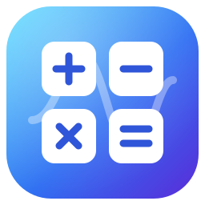
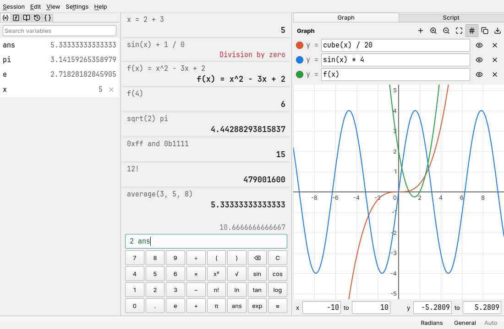

<p align="center">
  
</p>

<h1 align="center">Reckon</h1>

A calculator in the spirit of [SpeedCrunch](https://www.speedcrunch.org/),
written with Qt Quick: you type expressions, they go into a history with
their results, and variables and your own functions stay around. On top
of what SpeedCrunch does, Reckon plots `y = f(x)` curves the way the old
macOS Grapher did and runs JavaScript against the calculator, so a few
lines of script can define functions, fill variables and draw graphs.



## Download

Every night with new commits, the
[nightly release](https://github.com/iam-peter/reckon/releases/tag/nightly)
is rebuilt for Linux (an AppImage), Windows and macOS. The macOS app isn't
signed: open it with a right click and Open the first time.

On Debian and Ubuntu, Reckon can come from its APT repository instead,
which brings its own Qt:

```bash
sudo curl -fsSLo /usr/share/keyrings/reckon-archive-keyring.asc https://iam-peter.github.io/reckon/key.asc
echo "deb [signed-by=/usr/share/keyrings/reckon-archive-keyring.asc] https://iam-peter.github.io/reckon/apt stable main" | sudo tee /etc/apt/sources.list.d/reckon.list
sudo apt update && sudo apt install reckon
```

Put `nightly` in place of `stable` for the nightly builds.

## Using it

The window is the display with the expression line under it. Enter
evaluates; the result appears under the expression, right-aligned, and
becomes `ans`. While typing, the result so far shows above the line, the
expression is colored by what its parts are, and a popup completes the
names of functions and variables (Tab or Enter takes one). Up and Down
walk through earlier expressions, Escape clears the line. A click on an
expression or a result in the display puts it back into the line.

The side panel (Ctrl+P) has the variables, the built-in functions, a
table of constants, the history and your own functions, each with a
search box; a click inserts one. The keypad (Ctrl+K) has the digits,
operators and common functions for clicking.

### Expressions

- Numbers: `1.5e3`, `.5`, `0x1F`, `0b101`, `0o17`.
- Operators: `+ - * / ^` (also `**`), `!` for factorials, `mod` or `%`,
  `div` for integer division, `and or xor not` (also `& | ~`), `shl shr`
  (also `<< >>`), and the comparisons `== != < > <= >=`, which give 1 or
  0. `-2^2` is -4, `2^3^2` is 512.
- Multiplication without a sign: `2x`, `2(3 + 4)`, `2 pi`, `(1 + 1)(2 + 2)`.
- Variables: `x = 5`, also chained, `a = b = 1`, and inside expressions,
  `(y = 3) + y`. `pi`, `e` and `ans` are built in.
- Functions: `f(x, y) = x^2 + y` defines one, then `f(3, 1)`. The
  built-in ones are listed in the side panel: trigonometry (in radians or
  degrees, see the status bar), hyperbolics, logarithms, rounding,
  statistics of any number of values (`min`, `max`, `sum`, `average`,
  `median`, `stddev` …), `gcd`, `lcm`, `binomial`, `gamma`, and more.

Results come out in the format and precision set in the Settings menu or
the status bar: general, fixed, scientific, engineering, binary, octal or
hexadecimal, with automatic or a fixed number of decimals, optionally with
digits grouped in threes. Numbers are IEEE doubles, so there are 15
significant digits to go by.

### Sessions

The history, variables and functions are saved when Reckon closes and are
back when it starts. Session → Save As writes them to a JSON file, Open
brings one back, New clears everything; `reckon session.json` opens one.

### Graphs

View → Graph (Ctrl+G) opens the graph pane: a list of curves `y = …`,
each an expression in `x` that may use every variable and function the
calculator knows, in its own color (click the dot to change it), and the
plot under them. Drag pans, the wheel zooms at the pointer, a double
click goes back to the standard view, and the ranges can be typed at the
bottom. While the pointer is over the plot, every curve's value at that
`x` is shown. The curves follow the calculator: after `a = 2`, a curve
`a sin(x)` redraws. The graph can be copied or saved as a PNG.

### Scripts

View → Script (Ctrl+J) opens the script pane: a library of JavaScript
files, an editor and the output. Scripts see the calculator as `calc`:

```js
calc.eval("2 + 2")              // evaluates an expression, returns the number
calc.run("x = 5")               // evaluates into the history, as if typed
calc.get("x"); calc.set("x", 1); calc.has("x"); calc.ans
calc.define("cube", x => x * x * x)   // cube(3) now works in expressions
calc.undefine("cube")
calc.plot("sin(x)", "red"); calc.clearPlots()
calc.format(1 / 3)              // "0.333333333333333", like a result
calc.history()                  // [{expression, value, result, error}, …]
print("hello", 42)              // goes to the output
```

Ctrl+Enter runs the script; scripts are saved as you type, in the
application data folder. A function `calc.define`s takes as many
arguments as it declares; one declaring none, such as `(...v) => …`,
takes any number. A script named `startup` runs every time Reckon
starts, which is the place for functions you use often. The engine is
Qt's own JavaScript (QJSEngine), so `Math` and the rest of ECMAScript
are there; Python is not.

## Building

Requires Qt ≥ 6.9 and CMake ≥ 3.21.

```bash
cmake -B build -G Ninja -DCMAKE_PREFIX_PATH=$HOME/Qt/6.12.0/gcc_64
cmake --build build
ctest --test-dir build --output-on-failure
./build/src/reckon
```

`cmake --install build` also installs a desktop file and the icon.
`tst_ui` saves screenshots of the window when `RECKON_SCREENSHOT_DIR` is
set.

## Layout

- `src/core` — no Qt Quick dependency: the `Lexer` and `Parser` of the
  expression language, the `Environment` (variables, user and script
  functions, the angle unit) the expressions evaluate against, the
  built-in `Functions` and the table of `Constants`, the `Formatter` of
  results, the list `Models`, `Calculator` (the facade QML talks to:
  history, sessions, settings), `ScriptEngine` (QJSEngine with the `calc`
  object) and `ScriptLibrary` (the script files). QML module
  `Reckon.Core`.
- `src/ui` — `GraphView`, the item that samples and paints the curves;
  `ExpressionHighlighter` for the expression line; `Clipboard`, `Fonts`.
- `src/qml` — the window (`Main`), the `Display`, the `Editor` with its
  completer, the `Keypad`, the `SidePanel` with its `NameList`s, the
  `GraphPane` and the `ScriptPane`. QML module `Reckon`.

## Ideas

- Arbitrary precision and complex numbers, as SpeedCrunch has them.
- Unit conversions (`3 feet in meters`).
- Parametric and polar curves, and a table of values next to the graph.
- Python scripting next to JavaScript, by embedding CPython.
- A bit field view of the result.

## Third-party assets

- Icons: [Lucide](https://lucide.dev), ISC license (`src/icons/LICENSE.txt`).
- Fonts: [Inter](https://rsms.me/inter/) and
  [JetBrains Mono](https://www.jetbrains.com/lp/mono/), SIL Open Font
  License (`src/fonts/`).

## License

Reckon is released under the MIT license; see `LICENSE`. The icons and
fonts keep their own licenses.
